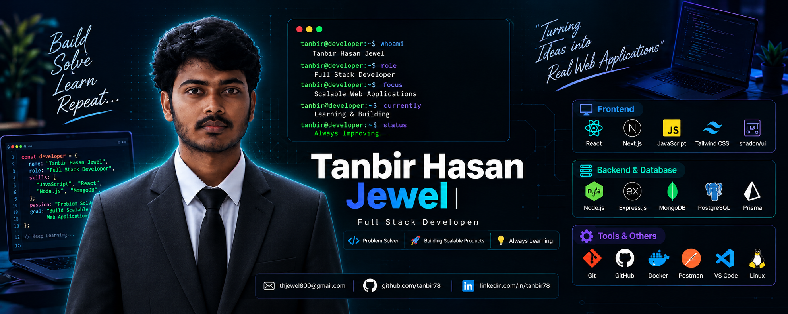

<!-- ═══════════════════════════════════════════ -->
<!--              BANNER SECTION                 -->
<!-- ═══════════════════════════════════════════ -->

<p align="center">
  
</p>

<!-- ═══════════════════════════════════════════ -->
<!--          NAME & DESIGNATION                 -->
<!-- ═══════════════════════════════════════════ -->

<div align="center">

  <br/>


&nbsp;

&nbsp;
<br/<br/>

<a href="mailto:thjewel800@gmail.com">
  
</a>
&nbsp;
<a href="https://github.com/tanbir78">
  
</a><br/><br/>


</div>

## 🧑‍💻 About Me

I'm **Tanbir Hasan Jewel**, a Full Stack Web Developer from Bangladesh 🇧🇩, passionate about building modern, responsive, and scalable web applications. I work with **React, Next.js, TypeScript, Node.js, Express.js, and MongoDB**, while also exploring tools and technologies that help me build better software.

Alongside web development, I regularly practice **Data Structures and Algorithms using C/C++** and solve competitive programming problems. I enjoy turning ideas into practical projects, improving my problem-solving skills, and writing clean, maintainable code.

- 🎓 **Background:** B.Sc. in Computer Science and Engineering
- 💻 **Focus:** Full Stack Web Development
- 🧠 **Problem Solving:** Data Structures & Algorithms in C++
- 🚀 **Goal:** Build impactful projects and become a stronger software engineer
- 🌱 **Currently Improving:** Full Stack Development, Competitive Programming & Interview Preparation
- 💬 **Ask me about:** React, JavaScript, Node.js, Express.js, MongoDB, C++, and DSA

<br/>

## 🚀 What I'm Up To

```yaml
🔭 Building:      Full-stack web applications
🌱 Learning:      Modern React, Next.js & TypeScript
🧠 Practicing:    Data Structures & Algorithms in C++
💻 Developing:    REST APIs with Node.js & Express.js
🗄️ Working with:  MongoDB, PostgreSQL & Prisma
🎨 Exploring:     Tailwind CSS, shadcn/ui & Framer Motion
🎯 Focusing on:   Competitive Programming & Interview Preparation
💬 Ask me about: React · JavaScript · Node.js · MongoDB · C++ · DSA
```

<br/>

## ⚡ Tech Arsenal

<div align="center">

**Frontend & UI**
<br/>


<br/><br/>

**Backend, Database & Authentication**
<br/>


<br/><br/>

**Programming Languages & Core CS**
<br/>


<br/><br/>

**Tools & DevOps**
<br/>


<br/><br/>

**Libraries & Technologies**

`Express.js` · `Prisma` · `Mongoose` · `NextAuth.js` · `Better Auth` · `Firebase Authentication` · `JWT` · `Zod` · `shadcn/ui` · `Framer Motion`

</div>

<br/>

<div align="center">

</div>

<br/>

## 🌐 Connect With Me

<div align="center">

[](https://github.com/tanbir78)
[](mailto:thjewel800@gmail.com)

</div>

<br/>

## 🧩 Competitive Programming

<div align="center">

[](https://codeforces.com/profile/tanbir78)
[](https://leetcode.com/u/tanbir78_/)

</div>

<br/>

<div align="center">

</div>

<br/>

## 📊 GitHub Stats & Streak

<div align="center">


<br/><br/>


</div>

<br/>

## 🗓️ Contribution Activity

<div align="center">

</div>

<br/>

## 🐍 Contribution Snake

<div align="center">
  <picture>
    <source media="(prefers-color-scheme: dark)" srcset="https://raw.githubusercontent.com/tanbir78/tanbir78/output/github-contribution-grid-snake-dark.svg" />
    <source media="(prefers-color-scheme: light)" srcset="https://raw.githubusercontent.com/tanbir78/tanbir78/output/github-contribution-grid-snake.svg" />
    
  </picture>
</div>

<br/>

<div align="center">

</div>

<br/>

## 💬 Dev Quote of the Day

<div align="center">

</div>

<br/>

---

<div align="center">


<br/>

*⭐ If you find my projects useful, consider giving them a star!*

</div>
